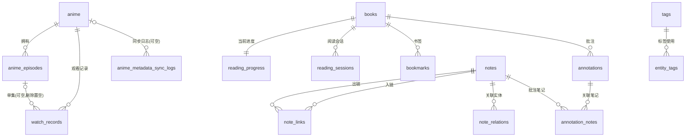

# AniShelf 数据库设计（阶段 2）

> 状态：**待确认**。本文档经用户确认后才创建 migration；确认前不写任何 schema 变更。
>
> 依据：`TECHNICAL_DESIGN.md` 第 2–3 节、`PRODUCT_REQUIREMENTS.md` 第 5 节、`CLAUDE.md` 第 5 节。

## 1. 设计约定

| 项目 | 约定 |
| --- | --- |
| 数据库 | SQLite（SQLx 0.9，bundled SQLite 3.51，已含 FTS5） |
| 文件位置 | `%LOCALAPPDATA%\com.anishelf.desktop\database\anishelf.sqlite` |
| 主键 | 实体表 `INTEGER PRIMARY KEY AUTOINCREMENT`（避免 rowid 复用）；关系表用复合主键 |
| 时间 | 统一 `INTEGER` 毫秒级 Unix 时间戳（UTC），由 Rust service 写入 |
| 布尔 | `INTEGER`，`CHECK (x IN (0,1))` |
| 枚举 | `TEXT` + `CHECK` 约束；界面显示中文，存储英文稳定值 |
| JSON | `TEXT` 保存 JSON 字符串，由 service 序列化/校验；列名以 `_json` 结尾 |
| 字符串 | 需要非空的字段用 `CHECK (length(trim(x)) > 0)` |
| 外键 | 统一 `REFERENCES ... ON DELETE ...`；连接必须 `PRAGMA foreign_keys = ON` |
| 多态关联 | 无数据库外键，存在性与清理由 service 在事务中保证（见第 5 节） |
| Migration | 只新增、不修改已应用文件；按版本事务执行；升级前备份 |

运行配置（连接级，不写进 migration）：

```text
PRAGMA foreign_keys = ON;
PRAGMA journal_mode = WAL;
PRAGMA synchronous = NORMAL;
PRAGMA busy_timeout = 5000;
```

## 2. ER 图（仅数据库外键）



多态关联（无外键、service 校验）：

- `note_relations.target_type + target_id` → `anime` / `book` / `episode` / `watch_record` / `annotation`
- `entity_tags.entity_type + entity_id` → `anime` / `book` / `note` / `annotation`
- `favorites.entity_type + entity_id` → `anime` / `book` / `note`
- `attachments.owner_type + owner_id` → `note` / `anime` / `book`
- `activity_logs.entity_type + entity_id` → 见数据字典（记录型，不强制存在）

## 3. 数据字典

### 3.1 番剧域

#### `anime`（番剧）

| 字段 | 类型 | 可空 | 约束/默认 | 说明 |
| --- | --- | --- | --- | --- |
| `id` | INTEGER | 否 | PK AUTOINCREMENT | 本地 ID |
| `bangumi_subject_id` | INTEGER | 是 | UNIQUE | Bangumi subject ID；手动条目为空 |
| `title` | TEXT | 否 | 非空 | 标题（外部元数据，可手动修改） |
| `original_title` | TEXT | 是 |  | 原名 |
| `aliases_json` | TEXT | 否 | 默认 `'[]'` | 别名数组 JSON |
| `summary` | TEXT | 否 | 默认 `''` | 简介（外部元数据） |
| `cover_path` | TEXT | 是 |  | 应用缓存的本地封面相对路径 |
| `cover_source_url` | TEXT | 是 |  | 外部封面 URL（不自动打开） |
| `year` | INTEGER | 是 | 1900–2200 | 年份 |
| `season` | TEXT | 是 | `winter/spring/summer/fall` | 季度 |
| `total_episodes` | INTEGER | 是 | ≥ 0 | 总集数 |
| `external_updated_at` | INTEGER | 是 |  | 外部元数据最近同步时间 |
| `watch_status` | TEXT | 否 | 默认 `wish`，五值枚举 | **个人字段**：想看/在看/已看/搁置/弃番 |
| `rating` | INTEGER | 是 | 1–10 | **个人字段**：评分 |
| `review` | TEXT | 否 | 默认 `''` | **个人字段**：个人评论 |
| `created_at` | INTEGER | 否 |  | 创建时间 |
| `updated_at` | INTEGER | 否 |  | 更新时间（任何修改） |

枚举 `watch_status`：`wish`、`watching`、`completed`、`on_hold`、`dropped`。

索引：`UNIQUE(bangumi_subject_id)`、`(watch_status)`、`(year)`、`(updated_at DESC)`。

#### `anime_episodes`（单集信息）

| 字段 | 类型 | 可空 | 约束/默认 | 说明 |
| --- | --- | --- | --- | --- |
| `id` | INTEGER | 否 | PK AUTOINCREMENT |  |
| `anime_id` | INTEGER | 否 | FK → anime ON DELETE CASCADE | 所属番剧 |
| `episode_number` | INTEGER | 否 | ≥ 1 | 集数 |
| `title` | TEXT | 否 | 默认 `''` | 单集标题 |
| `aired_at` | INTEGER | 是 |  | 播出时间（毫秒） |
| `created_at` | INTEGER | 否 |  |  |
| `updated_at` | INTEGER | 否 |  |  |

索引：`UNIQUE(anime_id, episode_number)`、`(anime_id)`。

> “已看/未看”不重复存布尔值，由 `watch_records` 是否存在推导，避免双写不一致。

#### `watch_records`（观看记录）

| 字段 | 类型 | 可空 | 约束/默认 | 说明 |
| --- | --- | --- | --- | --- |
| `id` | INTEGER | 否 | PK AUTOINCREMENT |  |
| `anime_id` | INTEGER | 否 | FK → anime ON DELETE CASCADE |  |
| `episode_id` | INTEGER | 是 | FK → anime_episodes ON DELETE SET NULL | 单集删除后保留历史 |
| `episode_number` | INTEGER | 否 | ≥ 1 | 观看时的集数快照（支持补录/多次观看） |
| `watched_at` | INTEGER | 否 |  | 观看时间（可补录到过去） |
| `comment` | TEXT | 否 | 默认 `''` | 单集快速感想；长文感想走笔记关联 |
| `created_at` | INTEGER | 否 |  |  |

索引：`(anime_id, watched_at DESC)`、`(episode_id)`、`(watched_at DESC)`。

#### `anime_metadata_sync_logs`（Bangumi 同步日志）

| 字段 | 类型 | 可空 | 约束/默认 | 说明 |
| --- | --- | --- | --- | --- |
| `id` | INTEGER | 否 | PK AUTOINCREMENT |  |
| `anime_id` | INTEGER | 是 | FK → anime ON DELETE SET NULL | 番剧删除后保留日志 |
| `bangumi_subject_id` | INTEGER | 是 |  | 外部 ID 快照 |
| `status` | TEXT | 否 | `success/partial/error` |  |
| `message` | TEXT | 否 | 默认 `''` | 可读错误/摘要（不含 Token） |
| `fields_updated_json` | TEXT | 否 | 默认 `'[]'` | 本次更新的字段名列表 |
| `started_at` | INTEGER | 否 |  |  |
| `finished_at` | INTEGER | 是 |  |  |

索引：`(anime_id, started_at DESC)`。

### 3.2 书籍与阅读域

#### `books`（书籍）

| 字段 | 类型 | 可空 | 约束/默认 | 说明 |
| --- | --- | --- | --- | --- |
| `id` | INTEGER | 否 | PK AUTOINCREMENT |  |
| `title` | TEXT | 否 | 非空 | 书名 |
| `author` | TEXT | 否 | 默认 `''` | 作者 |
| `format` | TEXT | 否 | `epub/pdf/txt/markdown` | 格式 |
| `file_path` | TEXT | 否 |  | 原始文件绝对路径（只读引用） |
| `normalized_path` | TEXT | 否 | UNIQUE | 去重用的规范化路径（Windows 小写） |
| `file_size` | INTEGER | 否 | ≥ 0 | 字节 |
| `file_mtime` | INTEGER | 是 |  | 文件修改时间（毫秒），用于丢失/冲突检测 |
| `file_hash` | TEXT | 是 |  | SHA-256（导入时可选计算），重复内容检测 |
| `cover_path` | TEXT | 是 |  | 应用缓存的封面相对路径 |
| `description` | TEXT | 否 | 默认 `''` | 简介 |
| `category` | TEXT | 否 | 默认 `''` | 单分类文本（分类 + 标签组合使用） |
| `imported_at` | INTEGER | 否 |  | 导入时间 |
| `last_opened_at` | INTEGER | 是 |  | 最近打开时间 |
| `created_at` | INTEGER | 否 |  |  |
| `updated_at` | INTEGER | 否 |  |  |

索引：`UNIQUE(normalized_path)`、`(format)`、`(file_hash)`、`(updated_at DESC)`、`(last_opened_at DESC)`。

#### `reading_progress`（当前阅读位置，一書一行）

| 字段 | 类型 | 可空 | 约束/默认 | 说明 |
| --- | --- | --- | --- | --- |
| `book_id` | INTEGER | 否 | PK，FK → books ON DELETE CASCADE |  |
| `location_type` | TEXT | 否 | `epub_cfi/pdf_page/txt_offset/md_scroll` | 定位类型 |
| `location_json` | TEXT | 否 |  | 格式专属定位信息（CFI/页码/字符偏移/锚点+滚动） |
| `percent` | REAL | 否 | 0–1，默认 0 | 阅读百分比 |
| `updated_at` | INTEGER | 否 |  |  |

#### `reading_sessions`（阅读会话）

| 字段 | 类型 | 可空 | 约束/默认 | 说明 |
| --- | --- | --- | --- | --- |
| `id` | INTEGER | 否 | PK AUTOINCREMENT |  |
| `book_id` | INTEGER | 否 | FK → books ON DELETE CASCADE |  |
| `started_at` | INTEGER | 否 |  |  |
| `ended_at` | INTEGER | 是 |  |  |
| `duration_ms` | INTEGER | 是 | ≥ 0 | 阅读时长 |
| `start_location_json` | TEXT | 是 |  |  |
| `end_location_json` | TEXT | 是 |  |  |

索引：`(book_id, started_at DESC)`、`(started_at DESC)`。

#### `bookmarks`（书签）

| 字段 | 类型 | 可空 | 约束/默认 | 说明 |
| --- | --- | --- | --- | --- |
| `id` | INTEGER | 否 | PK AUTOINCREMENT |  |
| `book_id` | INTEGER | 否 | FK → books ON DELETE CASCADE |  |
| `location_type` | TEXT | 否 | 同阅读位置枚举 |  |
| `location_json` | TEXT | 否 |  |  |
| `label` | TEXT | 否 | 默认 `''` | 书签名称/摘录 |
| `created_at` | INTEGER | 否 |  |  |

索引：`(book_id, created_at DESC)`。

#### `annotations`（批注）

| 字段 | 类型 | 可空 | 约束/默认 | 说明 |
| --- | --- | --- | --- | --- |
| `id` | INTEGER | 否 | PK AUTOINCREMENT |  |
| `book_id` | INTEGER | 否 | FK → books ON DELETE CASCADE |  |
| `kind` | TEXT | 否 | `highlight/note` | 高亮或文本批注 |
| `selected_text` | TEXT | 否 | 默认 `''` | 选中的原文 |
| `location_type` | TEXT | 否 | 同阅读位置枚举 |  |
| `location_json` | TEXT | 否 |  |  |
| `note` | TEXT | 否 | 默认 `''` | 批注内容 |
| `color` | TEXT | 是 |  | 高亮颜色 token |
| `created_at` | INTEGER | 否 |  |  |
| `updated_at` | INTEGER | 否 |  |  |

索引：`(book_id, created_at DESC)`。

#### `reader_settings`（阅读器设置）

| 字段 | 类型 | 可空 | 约束/默认 | 说明 |
| --- | --- | --- | --- | --- |
| `scope` | TEXT | 否 | PK，`global/epub/pdf/txt/markdown` | 全局或按格式 |
| `preferences_json` | TEXT | 否 | 默认 `'{}'` | 字号、行距、主题、缩放等 |
| `updated_at` | INTEGER | 否 |  |  |

### 3.3 笔记域

#### `notes`（笔记）

| 字段 | 类型 | 可空 | 约束/默认 | 说明 |
| --- | --- | --- | --- | --- |
| `id` | INTEGER | 否 | PK AUTOINCREMENT |  |
| `title` | TEXT | 否 | 默认 `''` | 标题（可为空，由正文首行展示） |
| `content_md` | TEXT | 否 | 默认 `''` | Markdown 正文 |
| `created_at` | INTEGER | 否 |  |  |
| `updated_at` | INTEGER | 否 |  |  |

约束：`CHECK (length(trim(title)) > 0 OR length(trim(content_md)) > 0)`。
索引：`(updated_at DESC)`、`(created_at DESC)`。

#### `note_links`（笔记双向链接）

| 字段 | 类型 | 可空 | 约束/默认 | 说明 |
| --- | --- | --- | --- | --- |
| `source_note_id` | INTEGER | 否 | PK 之一，FK → notes CASCADE | 来源笔记 |
| `target_note_id` | INTEGER | 否 | PK 之一，FK → notes CASCADE | 目标笔记 |
| `created_at` | INTEGER | 否 |  |  |

约束：`PRIMARY KEY(source_note_id, target_note_id)`、`CHECK(source_note_id <> target_note_id)`。
索引：`(target_note_id)`（反向链接查询）。

#### `note_relations`（笔记与实体关联，多态）

| 字段 | 类型 | 可空 | 约束/默认 | 说明 |
| --- | --- | --- | --- | --- |
| `id` | INTEGER | 否 | PK AUTOINCREMENT |  |
| `note_id` | INTEGER | 否 | FK → notes ON DELETE CASCADE |  |
| `target_type` | TEXT | 否 | `anime/book/episode/watch_record/annotation` |  |
| `target_id` | INTEGER | 否 |  | 由 service 校验存在 |
| `created_at` | INTEGER | 否 |  |  |

约束：`UNIQUE(note_id, target_type, target_id)`。
索引：`(target_type, target_id)`、`(note_id)`。

#### `tags`（标签）

| 字段 | 类型 | 可空 | 约束/默认 | 说明 |
| --- | --- | --- | --- | --- |
| `id` | INTEGER | 否 | PK AUTOINCREMENT |  |
| `name` | TEXT | 否 | `COLLATE NOCASE UNIQUE`，非空 | 标签名 |
| `color` | TEXT | 是 |  | 可选颜色 token |
| `created_at` | INTEGER | 否 |  |  |

#### `entity_tags`（标签与实体关联，多态）

| 字段 | 类型 | 可空 | 约束/默认 | 说明 |
| --- | --- | --- | --- | --- |
| `entity_type` | TEXT | 否 | `anime/book/note/annotation` |  |
| `entity_id` | INTEGER | 否 |  | 由 service 校验存在 |
| `tag_id` | INTEGER | 否 | FK → tags ON DELETE CASCADE |  |
| `created_at` | INTEGER | 否 |  |  |

主键：`(entity_type, entity_id, tag_id)`；索引：`(tag_id)`、`(entity_type, entity_id)`。

#### `annotation_notes`（批注 ↔ 笔记，在 notes/annotations 之后创建）

| 字段 | 类型 | 可空 | 约束/默认 | 说明 |
| --- | --- | --- | --- | --- |
| `annotation_id` | INTEGER | 否 | PK 之一，FK → annotations CASCADE |  |
| `note_id` | INTEGER | 否 | PK 之一，FK → notes CASCADE |  |
| `created_at` | INTEGER | 否 |  |  |

主键：`(annotation_id, note_id)`；索引：`(note_id)`。

### 3.4 通用域

#### `app_settings`（应用设置）

| 字段 | 类型 | 可空 | 约束/默认 | 说明 |
| --- | --- | --- | --- | --- |
| `key` | TEXT | 否 | PK | 如 `theme`、`bangumi.token`、`reader.defaults` |
| `value_json` | TEXT | 否 |  | JSON 值 |
| `updated_at` | INTEGER | 否 |  |  |

> Bangumi Token 只存本机数据库，不写日志、不入 Git；设置页只显示是否已配置。

#### `favorites`（收藏，多态）

| 字段 | 类型 | 可空 | 约束/默认 | 说明 |
| --- | --- | --- | --- | --- |
| `entity_type` | TEXT | 否 | `anime/book/note` |  |
| `entity_id` | INTEGER | 否 |  | 由 service 校验存在 |
| `created_at` | INTEGER | 否 |  |  |

主键：`(entity_type, entity_id)`。

#### `attachments`（应用管理的附件）

| 字段 | 类型 | 可空 | 约束/默认 | 说明 |
| --- | --- | --- | --- | --- |
| `id` | INTEGER | 否 | PK AUTOINCREMENT |  |
| `owner_type` | TEXT | 否 | `note/anime/book` |  |
| `owner_id` | INTEGER | 否 |  | 由 service 校验存在 |
| `file_path` | TEXT | 否 |  | 相对 `attachments/` 的路径，禁止路径穿越 |
| `file_name` | TEXT | 否 |  | 原始文件名 |
| `mime_type` | TEXT | 否 | 默认 `application/octet-stream` |  |
| `file_size` | INTEGER | 否 | ≥ 0 |  |
| `created_at` | INTEGER | 否 |  |  |

索引：`(owner_type, owner_id)`。

#### `activity_logs`（活动记录）

| 字段 | 类型 | 可空 | 约束/默认 | 说明 |
| --- | --- | --- | --- | --- |
| `id` | INTEGER | 否 | PK AUTOINCREMENT |  |
| `action_type` | TEXT | 否 | 非空 | 如 `anime.created`、`episode.watched`、`book.imported`、`note.updated` |
| `entity_type` | TEXT | 否 | `anime/episode/watch_record/book/annotation/note/tag/system` |  |
| `entity_id` | INTEGER | 是 |  | 实体删除后允许悬空（仅用于统计展示） |
| `summary` | TEXT | 否 | 默认 `''` | 可读摘要 |
| `metadata_json` | TEXT | 否 | 默认 `'{}'` | 附加数据 |
| `occurred_at` | INTEGER | 否 |  | 发生时间 |

索引：`(occurred_at DESC)`、`(entity_type, entity_id)`。

### 3.5 FTS5 虚拟表

| 表 | 内容表 | 索引列 | tokenizer |
| --- | --- | --- | --- |
| `anime_fts` | `anime` | `title`, `original_title`, `aliases_json`, `summary` | `trigram` |
| `books_fts` | `books` | `title`, `author`, `description` | `trigram` |
| `notes_fts` | `notes` | `title`, `content_md` | `trigram` |
| `annotations_fts` | `annotations` | `selected_text`, `note` | `trigram` |

每张 FTS 表使用 `content='<源表>'`、`content_rowid='id'`，并为源表建立 **INSERT / UPDATE / DELETE** 三个同步触发器（UPDATE = 先 delete 再 insert）。迁移 0008 创建，测试覆盖 `integrity-check`。

## 4. 索引与唯一约束汇总

| 表 | 唯一约束 |
| --- | --- |
| `anime` | `bangumi_subject_id` |
| `anime_episodes` | `(anime_id, episode_number)` |
| `books` | `normalized_path` |
| `reading_progress` | `book_id`（主键） |
| `reader_settings` | `scope`（主键） |
| `tags` | `name`（NOCASE） |
| `note_links` | `(source_note_id, target_note_id)` |
| `note_relations` | `(note_id, target_type, target_id)` |
| `entity_tags` | `(entity_type, entity_id, tag_id)` |
| `annotation_notes` | `(annotation_id, note_id)` |
| `favorites` | `(entity_type, entity_id)` |
| `app_settings` | `key`（主键） |

其余索引见各表说明；查询热点（状态/年份/更新时间/活动时间）均已覆盖。

## 5. 删除策略与多态清理

### 5.1 数据库级联

| 删除对象 | 行为 |
| --- | --- |
| `anime` | `anime_episodes`、`watch_records` CASCADE；`anime_metadata_sync_logs.anime_id` SET NULL |
| `anime_episodes` | `watch_records.episode_id` SET NULL（记录保留集数快照） |
| `books` | `reading_progress`、`reading_sessions`、`bookmarks`、`annotations` CASCADE |
| `annotations` | `annotation_notes` CASCADE |
| `notes` | `note_links`（出入链）、`note_relations`、`annotation_notes` CASCADE |
| `tags` | `entity_tags` CASCADE |

### 5.2 Service 层必须完成的多态清理（同一事务）

- 删除 `anime`：`note_relations(target_type='anime')`、`entity_tags('anime')`、`favorites('anime')`。
- 删除 `anime_episodes`：`note_relations('episode')`。
- 删除 `watch_records`：`note_relations('watch_record')`。
- 删除 `books`：先收集该书所有 `annotations.id`，删除 `note_relations('book')` 与这些 annotation 的 `note_relations('annotation')`、`entity_tags('book')`、`entity_tags('annotation')`、`favorites('book')`。
- 删除 `annotations`：`note_relations('annotation')`、`entity_tags('annotation')`。
- 删除 `notes`：`entity_tags('note')`、`favorites('note')`（其余由级联处理）。
- 删除 `attachments` 所有者：删除附件记录与应用内文件。

> 删除笔记前若有其他笔记引用，UI 必须提示引用影响；不得静默破坏关系。

## 6. Bangumi 同步字段边界

- **允许同步覆盖的外部字段**：`bangumi_subject_id`、`title`、`original_title`、`aliases_json`、`summary`、`cover_source_url`、`cover_path`、`year`、`season`、`total_episodes`、`external_updated_at`。
- **永不同步覆盖的个人字段**：`watch_status`、`rating`、`review`；以及 `watch_records`、`entity_tags`、`note_relations`、`notes`。
- 同步前若有字段差异，UI 展示变更并让用户确认（阶段 3 实现冲突策略与日志）。
- 同步失败只写 `anime_metadata_sync_logs`，不改动本地业务数据。

## 7. 中文全文检索方案

- FTS5 `trigram`：支持 ≥ 3 个 Unicode 字符的子串检索，无需中文分词。
- 查询长度 ≥ 3：使用 `MATCH` 短语（转义双引号），按 `bm25` 排序。
- 查询长度 1–2：FTS5 trigram 不命中，降级为对源表的 `LIKE '%q%' ESCAPE '\'`（转义 `%`、`_`、`\`），每种实体限制返回条数（如 50），UI 标注“模糊匹配”。
- 标签检索通过 `tags.name LIKE` + `entity_tags` 关联。
- 性能限制：短查询为全表扫描，数据量增大后需评估 jieba-rs 等应用层分词索引。
- 必测：3/5 字中文子串、2 字降级、英文大小写、`%`/`_` 转义、更新后旧词失效、删除后不命中、`integrity-check`。

## 8. Migration 批次

| 文件 | 内容 |
| --- | --- |
| `0001_initial.sql` | `app_settings` |
| `0002_anime.sql` | `anime`、`anime_episodes`、`watch_records` + 索引 |
| `0003_books.sql` | `books`、`reading_progress`、`reading_sessions` + 索引 |
| `0004_reader_annotations.sql` | `bookmarks`、`annotations`、`reader_settings` + 索引 |
| `0005_notes.sql` | `notes`、`tags`、`entity_tags`、`note_links` + 索引 |
| `0006_relations.sql` | `note_relations`、`annotation_notes`、`favorites`、`attachments` + 索引 |
| `0007_activity_logs.sql` | `activity_logs`、`anime_metadata_sync_logs` + 索引 |
| `0008_search.sql` | 四张 FTS5 表 + 12 个同步触发器 |

依赖顺序：`annotation_notes` 必须在 `0005`（notes）和 `0004`（annotations）之后；FTS 在全部源表之后。

## 9. 测试计划

- Migration：空库全量迁移；重复启动不重复执行；checksum 不变；迁移前备份成功且可打开。
- 外键：非法 `anime_id` 插入失败；删除番剧级联集数与观看记录；删除单集后观看记录保留且 `episode_id` 为空。
- 约束：重复 `(anime_id, episode_number)`、重复 `normalized_path`、重复标签名（大小写）失败。
- FTS：四张表的新增/更新/删除同步；`integrity-check`；中文 3/5 字命中、2 字 LIKE 降级、特殊字符转义。
- Service：多态关联存在性校验与删除清理；Bangumi 同步不触碰个人字段（阶段 3 实现真实同步前先用 service 单测）。
- 备份：`VACUUM INTO` 产物可打开且包含已提交数据；备份失败中止迁移。

## 10. 待确认事项

1. 番剧评分范围采用 **1–10**（与 Bangumi 一致）。
2. 季度采用 **winter/spring/summer/fall** 英文枚举（界面显示中文）。
3. 书籍分类采用 **单分类文本 + 标签** 组合（不做多级分类表）。
4. 观看状态内部存英文枚举，界面显示中文。
5. 所有时间统一毫秒级 UTC 时间戳。

用户确认以上设计后，再开始创建 migration。
